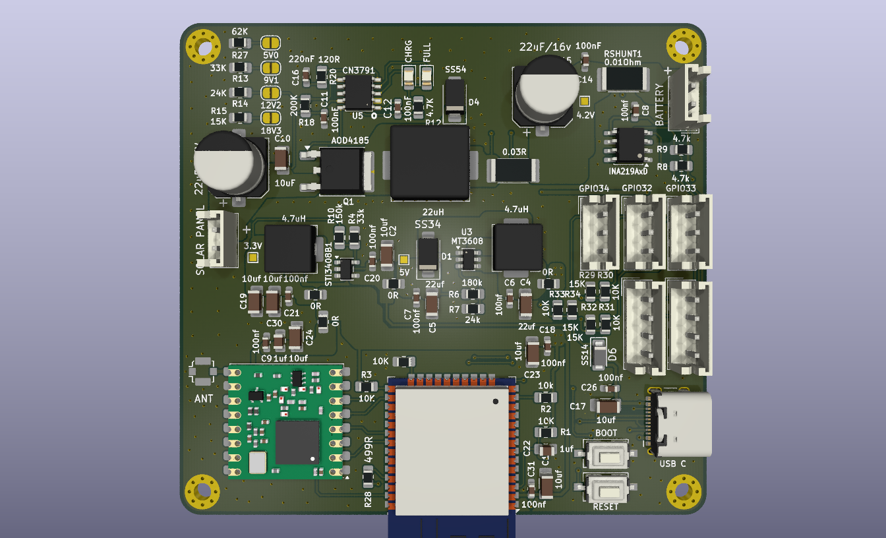
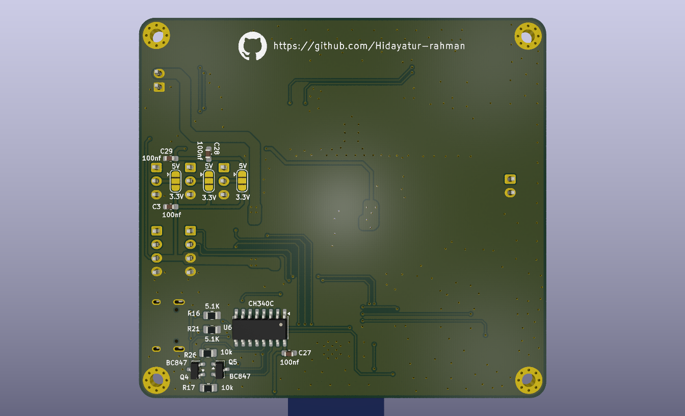
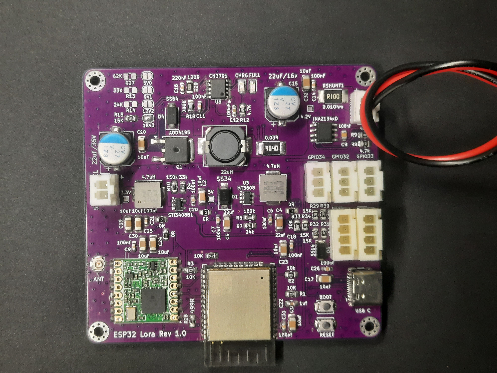
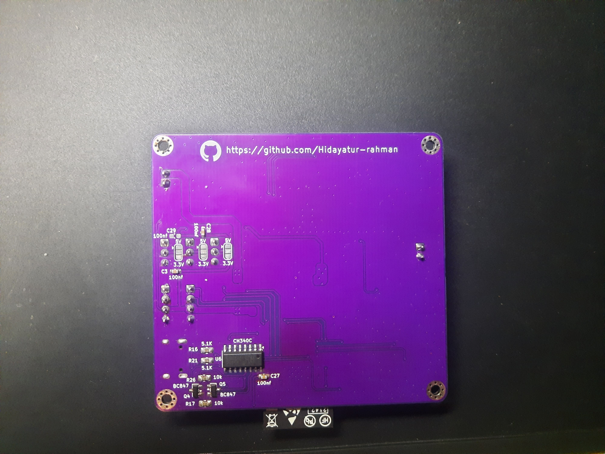
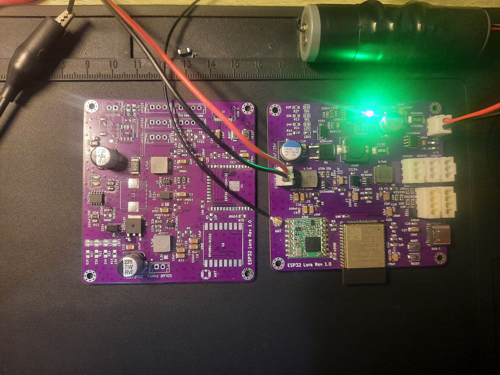
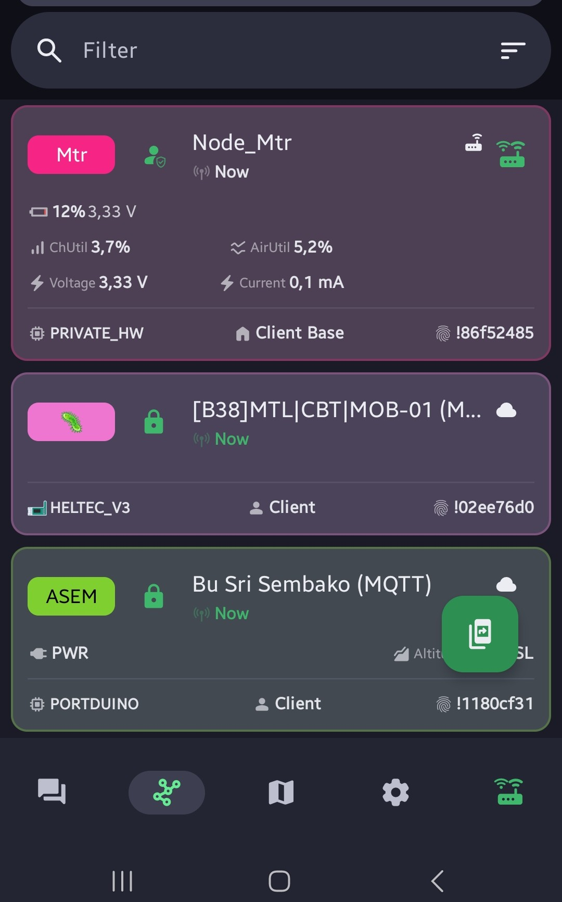
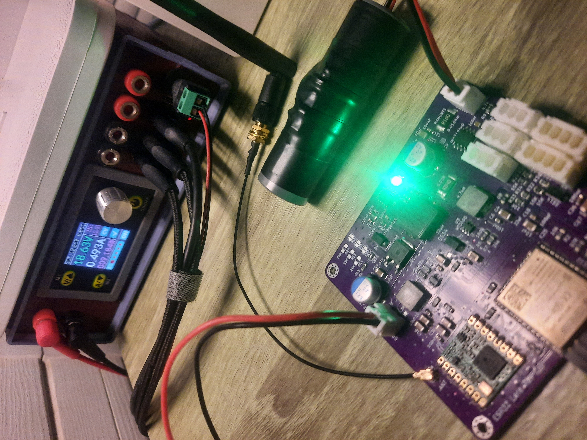
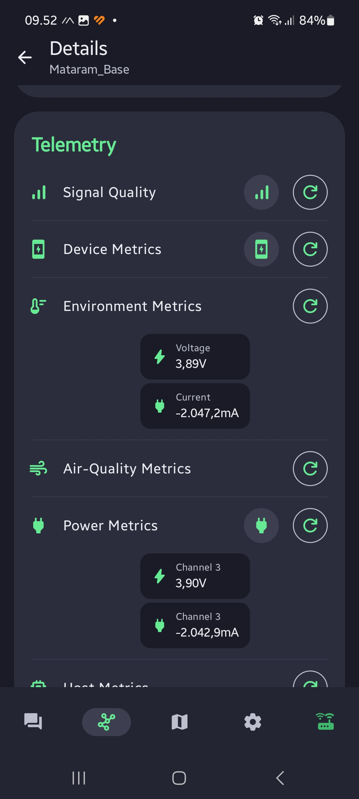
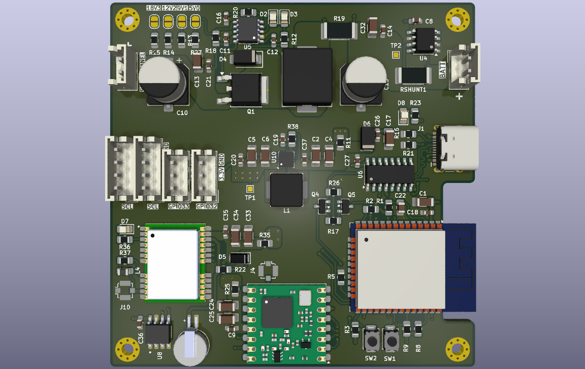
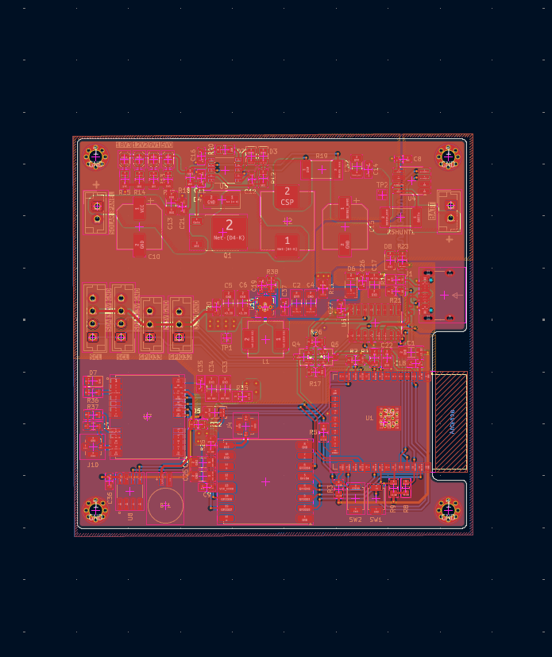

# ESP32 LoRa Solar Node Meshtastic Board

A solar-powered ESP32 + LoRa (RFM95W) node board. It charges a single-cell Li-ion battery from a solar panel with MPPT (CN3791), generates stable 5V and 3.3V rails, monitors battery voltage and current (INA219), and programs over USB-C (CH340C with auto-reset).

**Board:** 2-layer PCB, 75 × 70 mm, 1.6 mm  
**Design tool:** KiCad 10  
**Revision:**  rev 1, 2026-10-13

## Table of Contents

- [3D View](#3d-view)
- [PCB](#pcb)
- [Features](#features)
- [Power Path](#power-path)
- [Pin Mapping](#pin-mapping)
- [Connectors](#connectors)
- [Solder Jumpers](#solder-jumpers)
- [MPPT Voltage Setting (CN3791)](#mppt-voltage-setting-cn3791)
- [MPPT Test Result](#mppt-test-result-bench-power-supply)
- [Main Components](#main-components)
- [Usage Notes](#usage-notes)
- [Firmware](#firmware)
- [Roadmap](#roadmap)
- [License](#license)
- [Disclaimer](#disclaimer)

## 3d View

<p align="center">
  
  
</p>

## PCB

<p align="center">
  
  
</p>

<p align="center">
  
  
</p>

## Features

- ESP32-WROOM-32 module
- LoRa radio: RFM95W-915S2 (915 MHz) with U.FL antenna connector
- Solar MPPT charger: CN3791 for a 1S Li-ion/LiPo battery (4.2 V)
- Solder jumpers to set the solar panel MPPT voltage: 5 V / 9 V / 12 V / 18 V
- P-MOSFET (AOD4185) in the solar charge path
- INA219 current/voltage monitor with a 10 mΩ shunt on the battery line
- MT3608 boost converter (battery → 5 V)
- STI3408B buck converter (5 V → 3.3 V)
- USB-C programming port with CH340C and automatic reset/boot (DTR/RTS)
- Charge and done LEDs from the CN3791
- 2 × I2C ports and 3 × ADC sensor ports (JST-EH), each with selectable sensor supply (5 V or 3.3 V)
- Reset and Boot buttons
- Test points for 3.3 V, 5 V and 4.2 V
- 0 Ω links in the power path (useful for measuring current or isolating a section)

## Power Path

```
Solar panel ──► Q1 (P-MOSFET) ──► CN3791 MPPT ──► INA219 shunt ──► Battery (4.2 V)
                                                                       │
                                  ESP32 / LoRa / sensors ◄── 3.3 V ◄── 5 V (MT3608 boost) ◄─┘
                                                              STI3408B buck
```

> ⚠️ **BATTERY WARNING**  
> This board has **no BMS** and **no reverse polarity protection** on the battery input. The CN3791 only charges the cell, it does not protect it from over-discharge, over-current or short circuit. Connecting the battery the wrong way round can destroy the board and may cause a fire. **Always use a battery that already has a built-in BMS / protection circuit.**

## Pin Mapping

| ESP32 Pin | Function |
|---|---|
| GPIO18 | LoRa SCK |
| GPIO19 | LoRa MISO |
| GPIO23 | LoRa MOSI |
| GPIO4 | LoRa NSS (CS) |
| GPIO14 | LoRa RESET |
| GPIO26 | LoRa DIO0 |
| GPIO27 | LoRa DIO1 |
| GPIO21 | I2C SDA (INA219, J2, J3) |
| GPIO22 | I2C SCL (INA219, J2, J3) |
| GPIO32 | ADC port 1 (J7) |
| GPIO33 | ADC port 2 (J8) |
| GPIO34 | ADC port 3 (J9) |
| GPIO0 | Boot button / auto-reset |
| EN | Reset button / auto-reset |
| GPIO1 / GPIO3 | TX / RX to CH340C |

Each ADC input has a 10 kΩ / 15 kΩ divider, so a 5 V sensor output is scaled to about 3 V.

## Connectors

| Ref | Name | Description |
|---|---|---|
| J1 | USB-C | Programming and serial |
| J4 | U.FL | LoRa antenna |
| J5 | Battery | 1S Li-ion/LiPo (GND, BATT+) |
| J6 | Solar panel | Panel input (VCC, GND) |
| J2, J3 | I2C | SCL, SDA, 3.3 V, GND |
| J7, J8, J9 | ADC | Signal, sensor supply, GND |

## Solder Jumpers

| Ref | Function |
|---|---|
| 5V0, 9V1, 12V2, 18V3 | Select the solar panel MPPT voltage. Close only one. |
| JP1, JP3, JP4 | Select the supply of ADC port 1, 2 and 3: 5 V or 3.3 V |

## MPPT voltage setting (CN3791)

The CN3791 regulates the solar panel voltage so that the MPPT pin sits at about 1.04 V (typical value from the datasheet; please verify against your datasheet revision). A resistor divider sets the panel voltage:

```
VCC (panel) ── R18 200k ──┬── MPPT pin
                          │
                        R_bottom (selected by jumper)
                          │
                         GND

V_panel = 1.04 V × (1 + R18 / R_bottom)
```

| Jumper | R_bottom | Regulated panel voltage | Suggested panel |
|---|---|---|---|
| 5V0 | R27 = 62 kΩ | ≈ 4.4 V | 5–6 V panel |
| 9V1 | R13 = 33 kΩ | ≈ 7.3 V | 9 V panel |
| 12V2 | R14 = 24 kΩ | ≈ 9.7 V | 12 V panel |
| 18V3 | R15 = 15 kΩ | ≈ 14.9 V | 18 V panel |

To use a different panel, choose the bottom resistor from the panel's maximum power voltage (Vmp):

```
R_bottom = R18 / (Vmp / 1.04 − 1)
```

Example: Vmp = 17 V → R_bottom = 200k / (17 / 1.04 − 1) ≈ 13 kΩ (use 13 kΩ or the nearest standard value, 12 kΩ or 15 kΩ).

Keep the panel's open-circuit voltage (Voc) below the CN3791 input limit (about 28 V).

## Mppt Test Result (Bench Power Supply)

 <p align="center">
  
  
</p>

The CN3791 charger was tested with a bench power supply instead of a solar panel, and the INA219 readings were compared with the supply readings.

| Item | Value |
|---|---|
| Input voltage (bench supply) | 18.6 V |
| Input current | 0.49 A |
| Input power | ≈ 9.1 W |
| INA219 bus voltage (battery) | 3.89 V |
| INA219 charge current | 2.04 A |
| Battery charge power | ≈ 7.9 W |
| Estimated efficiency | ≈ 87 % |


## Main Components

| Ref | Part |
|---|---|
| U1 | ESP32-WROOM-32 |
| U2 | RFM95W-915S2 (LoRa) |
| U3 | MT3608 (boost) |
| STI3408B1 | STI3408B (buck) |
| U4 | INA219 |
| U5 | CN3791 (MPPT charger) |
| U6 | CH340C (USB-UART) |
| Q1 | AOD4185 (P-MOSFET) |
| Q4, Q5 | BC847 (auto-reset) |
| RSHUNT1 | 0.01 Ω, 2512 |
| L1, L3 / L2 | 4.7 µH / 22 µH |

## Usage Notes

- Close **only one** MPPT jumper (5V0, 9V1, 12V2 or 18V3), based on your solar panel's maximum power voltage.
- Use a single-cell Li-ion/LiPo battery. The CN3791 in this design charges to 4.2 V.
- The RFM95W-915S2 covers the 915 MHz band. Check the allowed LoRa frequency in your country before use, and always attach an antenna before transmitting.
- Upload firmware over USB-C. Auto-reset is handled by the CH340C, so no button presses are needed.
- INA219 is on the I2C bus together with J2 and J3, so avoid address conflicts with your sensors.
- The INA219 address (0x40) is the default. Check the A0/A1 pins in the schematic if you changed it.

## Firmware

- Firmware: Meshtastic custom build
- Target: `esp32_rfm95_custom`
- Version: `2.8.3`
- Revision: `d9c9916`

| Signal | ESP32 Pin |
|---|---|
| SCK / MISO / MOSI | GPIO18 / GPIO19 / GPIO23 |
| NSS (CS) | GPIO4 |
| RESET | GPIO14 |
| DIO0 / DIO1 | GPIO26 / GPIO27 |
| I2C SDA / SCL | GPIO21 / GPIO22 |

Set the LoRa region in Meshtastic to match your country and the 915 MHz hardware.

## Roadmap
 
**Version 2 (in progress)**
<p align="center">
  
  \
</p>

- 4-layer PCB
- GPS module added

This repository currently contains version 1 (2-layer, no GPS). Version 2 files will be added when the design is ready.

## License

MIT — feel free to use, modify, and build upon this project.

## Disclaimer

This is a hobbyist/DIY project. Double-check battery polarity and solar jumper settings before powering on. No warranty is provided — build and use at your own risk.
